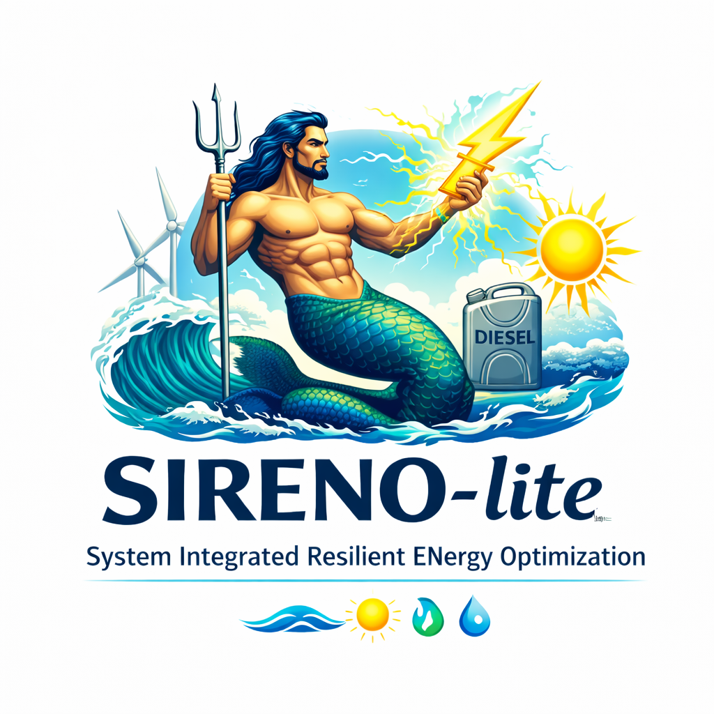

# SIRENO-lite (System-Integrated Resilient ENergy Optimizer)

[](https://github.com/JuliaOceanWaves/SIRENO-Lite/actions/workflows/tests.yml)
[](https://github.com/JuliaOceanWaves/SIRENO-Lite/actions/workflows/tests.yml)
[](https://github.com/JuliaOceanWaves/SIRENO-Lite/actions/workflows/docs.yml)
[](https://github.com/JuliaOceanWaves/SIRENO-Lite/actions/workflows/build_gui.yml)
[](https://github.com/JuliaOceanWaves/SIRENO-Lite/releases/latest)



SIRENO-lite provides a local HiGHS paper-mission optimizer and a GEKKO dynamic optimization model for sizing and dispatching a hybrid system with wind, solar, wave, generator, battery, hydrogen production/storage, and potable water production/storage.

NOTE: Heavy AI assistance was used for developing the GUI, the docs, tests, reorganization, logo, and some additions to the base hybrid system optimization script.  Please use with caution and note the NOTICE and LICENSE file limitations on guarantees etc.

Documentation: [User guide](https://juliaoceanwaves.github.io/SIRENO-lite/), [model equations](docs/theory.md), [paper reproduction](docs/paper-reproducibility.md), [human review checklist](docs/human-review.md), and [1.1 release audit](RELEASE_AUDIT_1.1.md).

SIRENO-lite uses normalized resource profiles for qualitative architecture screening. Results guide further device and site analysis; they do not establish hardware ratings or experimental validation.

## Install and run

```bash
python3 -m venv .venv
source .venv/bin/activate
python -m pip install .
sirenolite-gui
```

Python 3.9+ and Tk are required for the desktop GUI. On Windows, activate with `.venv\Scripts\Activate.ps1`. Local solving is the default.

The GUI starts with the paper’s **Hawaii combined-service, 8760-hour case**, ready to solve. In **Inputs**, choose one of 19 prepared locations, a mission and horizon, or browse to a custom resource CSV. Review the costs and capacity bounds, then choose **Run / Plot → Run**. Results show generation and storage pies beside the hourly history, with CSV/PDF export. Unchecking a sizing control fixes that capacity to its configured minimum.

Paper mode uses cyclic inventories, local-solar service schedules and integer diesel deliveries; all prepared resource data are bundled for offline use. Legacy JSON examples and hydrogen studies use GEKKO. The CLI’s historical default remains available; save the GUI configuration to run the same paper case from the CLI.

For a command-line run without plot windows:

```bash
sirenolite --dump-config config.json
sirenolite --config config.json --output-dir results/my-case
```

Both interfaces read the same JSON settings and sizing flags. Relative CSV paths are relative to the JSON directory. See [Getting Started](docs/getting-started.md) for a first run and [Examples](docs/examples/index.md) for mission configurations.

The historical `nhrs` setting counts hourly samples: 25 samples span 24 solved hours. Row zero initializes inventory. `H2DailyDemand` and `H2ODailyDemand` are peak hourly demand rates, not automatic daily totals; check integrated service demand before interpreting results.

## Development and verification

```bash
python -m pip install -e ".[test,docs]"
python -m pytest
mkdocs build --strict
```

Node.js is required for browser-map core tests. Real Tk tests need a desktop session; Linux CI uses `xvfb-run -a python -m pytest`. Set `SIRENOLITE_REQUIRE_GUI_TESTS=1` to fail when real GUI execution is unavailable. Set `SIRENOLITE_BROWSER_TESTS=1` to require the real Chrome interaction test; `SIRENOLITE_CHROME` can specify the executable. Coverage includes GUI code; analytic physical results, rejected infeasible cases, and actual interface workflows are the acceptance criteria. A coverage percentage alone is insufficient.

Reproduce the annual paper designs from the bundled inputs and retained reference results:

```bash
# Five representative annual cases; use --all for all 76 mission/location pairs.
python scripts/verify_gui_paper_cases.py --hourly --output-dir results/paper-check
```

This command runs offline without the separate manuscript repository or Julia.
The [reproduction guide](docs/paper-reproducibility.md) explains the numerical
tolerances and the boundary between this annual comparison and other paper studies.

See [GUI_BUILD.md](GUI_BUILD.md) for standalone packaging and native solve checks,
and [CHANGELOG.md](CHANGELOG.md) for release changes. [Release downloads](https://github.com/JuliaOceanWaves/SIRENO-Lite/releases)
include platform GUI archives, Python distributions, and SHA-256 checksums.
